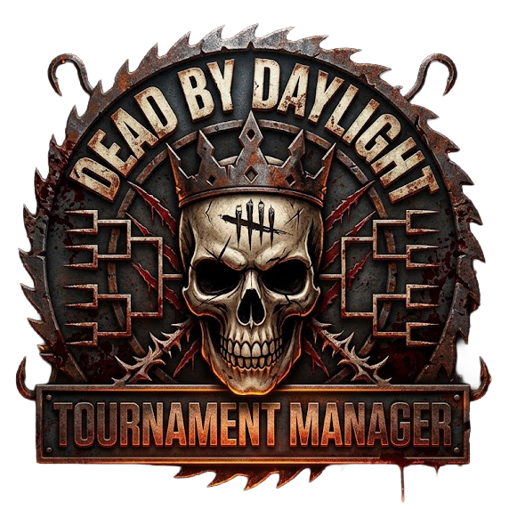

# Dead by Daylight Tournament Manager

<p align="center">
  
</p>

<p align="center">
  <strong>Live Web Application:</strong><br>
  <a href="https://pattechx.github.io/DBD-Tournament-Manager/">https://pattechx.github.io/DBD-Tournament-Manager/</a>
</p>

<p align="center">
  <strong>Language Selection / Sprachauswahl:</strong><br>
  <a href="#deutsch">Deutsch</a> &bull;
  <a href="#english">English</a> &bull;
  <a href="#espanol">Español</a> &bull;
  <a href="#francais">Français</a>
</p>

---

<a name="deutsch"></a>
## Deutsch

### Übersicht
Der **Dead by Daylight Tournament Manager** ist eine spezialisierte Desktop- und Web-Anwendung zur Organisation, Durchführung und statistischen Auswertung strukturierter Turniere im kompetitiven und privaten Rahmen. Das System bildet sowohl Killer- als auch Survivor-Wettbewerbe über mehrstufige Gruppen- und K.O.-Phasen ab und integriert ein automatisiertes Regelwerk für Loadouts, Zuweisungen und Tie-Breaker.

Die Software wird als native **Windows Desktop-Anwendung (NSIS Installer / Portable Executable)** sowie als plattformunabhängige **Web-Anwendung über GitHub Pages** bereitgestellt.

### Web-Version (Direkt im Browser)
Die Anwendung kann ohne Installation direkt im Webbrowser ausgeführt werden:
* **Online-Version:** [https://pattechx.github.io/DBD-Tournament-Manager/](https://pattechx.github.io/DBD-Tournament-Manager/)

### Spieler-Profile und Besitzverwaltung (Core Feature)
Ein zentraler Kern des Systems ist das integrierte Spieler- und Kontomanagement, das die realen Gegebenheiten der Konten aller Turnierteilnehmer abbildet:
* **Profilverwaltung (1–6 Teilnehmer):**
  * Individuelle Benennung, eindeutige Farbcodierung und Aktivierungsstatus je Spieler.
* **Granulare Besitzverwaltung (Roster & Ownership):**
  * Für jeden Spieler wird separat hinterlegt, welche Killer und Survivor auf seinem Spielkonto freigeschaltet sind.
  * Filterung nach Basisspiel, lizenzierten Kapiteln und DLCs.
  * Visuelle Warnhinweise im Match-Editor, sollte ein Spieler für einen nicht besessenen Charakter eingeteilt sein.
* **Prestige-System (P0 bis P3):**
  * Abbildung der Ingame-Prestigestufen (0 bis 3) je Charakter.
  * Das Erreichen von P1 bis P3 schaltet die teambezogenen Perks dieses Charakters automatisch rollenweit für den betreffenden Spieler frei.
* **Schrein der Geheimnisse (Shrine of Secrets):**
  * Gezielte Einzelfreischaltung von Perks für Spieler, die einzelne Perks über den Schrein erworben haben, ohne den dazugehörigen Charakter zu besitzen oder zu leveln.
* **Fairness- und Zuweisungs-Algorithmus:**
  * Automatische Zuweisung der menschlichen Spieler zu den einzelnen Match-Paarungen.
  * Berücksichtigung des realen Besitzstands (Spieler steuern bevorzugt nur Charaktere, die sie besitzen).
  * Ausgewogene Rotation von Einsatzzeiten, Charaktervielfalt und direkten Duell-Paarungen.
  * Schneller Spieler-Tausch im Match-Dialog mit einem Klick.

### Turniermodi und Regelwerke
* **Wettbewerbsformate:**
  * **Killer-Turnier:** Wertung über Opferungen (Kills) und Hakenstadien (Hooks) mit anpassbarer Tie-Breaker-Logik oder isolierten Wertungsmaßstäben.
  * **Survivor-Turnier:** Auswertung basierend auf erfolgreichen Fluchten (Escapes), reparierten Generatoren, Überlebensdauer in Sekunden oder kumulierten Blutpunkten.
* **Perk- und Ausrüstungsverwaltung:**
  * **Zufallsauswahl (Random):** Dynamische Zuweisung von 4 spielbaren Perks je Teilnehmer mit Einzel- oder Gesamtwürfelfunktion.
  * **Adept-Herausforderung:** Begrenzung auf die drei charaktereigenen Perks (vierter Slot gesperrt).
  * **Benutzerdefinierte Zuweisung (Custom):** Manuelle Auswahl über einen modalen Perk-Selektor mit integriertem Suchfilter und Kennzeichnung der Freischaltquelle (Allgemein, Prestige, Schrein).
  * **Perkless:** Hardcore-Modus ohne Perk-Ausstattung.
  * **Addon- und Gegenstandsmodul:** Automatische Bestimmung rollenspezifischer Addons (0–2) sowie Survivor-Gegenstände inklusive Event-Items.
* **Turnierstrukturen:**
  * **Gruppenphase (Round Robin):** Konfigurierbare Gruppengrößen, automatisierter Paarungsplan, faire Zuweisung der realen Spieler sowie fortlaufende Tabellenberechnung (Punkte, Tordifferenz, Spielstatistiken).
  * **K.O.-Endrunde (Knockout Bracket):** Automatische Ermittlung der Setzliste aus den Gruppenplatzierungen, automatischer Turnierbaum bis zum Finale sowie Ausspielung des dritten Platzes.
  * **Tie-Breaker-System:** Eindeutige Entscheidungsfindung bei Punkte- und Wertungsgleichstand in K.O.-Begegnungen.
* **Statistiken und Analyse:**
  * Leistungsauswertung menschlicher Spieler (Siegrate, Einsätze, Durchschnittswerte, Gesamtpunkte).
  * Gesamtrangliste sämtlicher beteiligter Charaktere.
  * Aggregierte Gesamtkennzahlen (Gesamtopfer, Hakenstadien, Spitzenreiter).
* **Datenpersistenz:**
  * Vollständiger Export und Import von Turnierständen und Spielerprofilen im JSON-Format.

### Windows Desktop-App & Downloads
Fertig kompilierte Installations- und Programmdateien stehen unter [GitHub Releases](https://github.com/PattechX/DBD-Tournament-Manager/releases) zum Download bereit:
* **Installationspaket:** `DBD Tournament Setup 1.0.0.exe` (erstellt Desktop- und Startmenü-Verknüpfungen inklusive Deinstallationsroutine).
* **Portable Version:** `DBD Tournament 1.0.0.exe` (direkt ausführbar ohne Installationsprozess).

### Entwicklungs- und Build-Befehle
Voraussetzung: Node.js (LTS Version 18 oder höher).

```bash
npm install     # Installation aller Entwicklungsabhängigkeiten
npm start       # Start der Anwendung im Entwicklungsmodus
npm run dist    # Kompilierung des Installers und der portablen .exe
```

### Rechtliche Hinweise und Copyright
* © Copyright by **Behaviour Interactive Inc.** – *Dead by Daylight* und alle zugehörigen Charaktere, Grafiken, Markenzeichen und Namen sind Eigentum von Behaviour Interactive Inc.
* **Designed by Dr. D. Erobert and Built with AI**

---

<a name="english"></a>
## English

### Overview
The **Dead by Daylight Tournament Manager** is a dedicated desktop and web application designed for structuring, administering, and analyzing organized competitive and casual tournaments. The software supports both Killer and Survivor formats across multi-stage group rounds and knockout brackets, offering automated management of loadouts, player rotation, and tie-breaking procedures.

The application is distributed as a native **Windows Desktop Application (NSIS Installer / Portable Executable)** and as a zero-install **Web Application deployed via GitHub Pages**.

### Web Application (Direct Browser Access)
The software can be executed instantly in any modern web browser:
* **Live Application:** [https://pattechx.github.io/DBD-Tournament-Manager/](https://pattechx.github.io/DBD-Tournament-Manager/)

### Player Profiles and Ownership Management (Core Feature)
A foundational architectural component of the manager is its granular player profile and inventory system, reflecting the real in-game account status of each competitor:
* **Profile Management (1–6 Competitors):**
  * Customizable names, unique identification colors, and active roster toggles per participant.
* **Granular Ownership Tracking (Roster & Ownership):**
  * Specific character ownership is maintained independently for each player across all Killers and Survivors.
  * Categorization by base game, licensed chapters, and DLC expansions.
  * Real-time warning badges within the match modal if a match assignment conflicts with account ownership.
* **Prestige Progression (P0 through P3):**
  * Tracks in-game prestige tiers (0 to 3) per character for each player.
  * Reaching P1–P3 automatically marks character-specific perks as globally unlocked for that player's role roster.
* **Shrine of Secrets Integration:**
  * Allows selective unlocking of individual teachable perks for players who bought specific perks via the Shrine without owning or leveling the character.
* **Smart Assignment Algorithm:**
  * Automatically rotates human players into match pairings while respecting their owned character inventory.
  * Mathematically optimizes balance across total match appearances, character diversity, and direct head-to-head match frequencies.
  * One-click swap functionality to exchange assigned competitors directly within the match view.

### Tournament Modes and Rulesets
* **Tournament Modes:**
  * **Killer Tournament:** Evaluated by sacrifices (kills) and hook stages with custom tie-breaker criteria or specialized scoring presets.
  * **Survivor Tournament:** Ranked by successful escapes, repaired generators, survival duration in seconds, or accumulated bloodpoints.
* **Perk and Loadout Systems:**
  * **Random Selection:** Dynamic allocation of four permissible perks per competitor per match with single or full reroll options.
  * **Adept Ruleset:** Strict limitation to three character-specific perks (fourth slot deactivated).
  * **Custom Loadout:** Manual selection via a searchable perk modal picker with unlock source indicators (General, Prestige, Shrine).
  * **Perkless:** Unperked tournament matches for baseline skill competition.
  * **Addon and Item Management:** Automatic assignment of killer addons (0–2) and survivor item/addon loadouts including seasonal event gear.
* **Tournament Formats:**
  * **Group Stage (Round Robin):** User-defined group sizing, automated scheduling, balanced human player piloting rotation, and live table calculations (points, goal differential, head-to-head records).
  * **Knockout Bracket:** Dynamic qualification and seeding generated from group outcomes, continuous progression to the championship final, and third-place match determination.
  * **Tie-Breaker Engine:** Conflict resolution for draw scenarios within single-elimination fixtures.
* **Analytics and Metrics:**
  * Real-time metrics tracking human player performance (win percentages, appearances, per-match averages, total tournament points).
  * Cumulative standings covering all participating characters.
  * Macro metrics including total tournament sacrifices, hook stages, and top performers.
* **State Management:**
  * Full snapshot serialization covering tournaments and player profiles via JSON export and import.

### Windows Distribution & Releases
Pre-compiled executable packages are available for download under [GitHub Releases](https://github.com/PattechX/DBD-Tournament-Manager/releases):
* **Installer:** `DBD Tournament Setup 1.0.0.exe` (NSIS setup program with desktop shortcuts and uninstaller).
* **Portable:** `DBD Tournament 1.0.0.exe` (self-contained executable requiring no installation).

### Build Instructions
Prerequisite: Node.js (LTS version 18 or newer).

```bash
npm install     # Install project dependencies
npm start       # Run locally in development environment
npm run dist    # Package installer and portable executables
```

### Legal Notice and Copyright
* © Copyright by **Behaviour Interactive Inc.** – *Dead by Daylight* and all associated characters, logos, trademarks, and names are properties of Behaviour Interactive Inc.
* **Designed by Dr. D. Erobert and Built with AI**

---

<a name="espanol"></a>
## Español

### Descripción General
El **Dead by Daylight Tournament Manager** es una aplicación técnica diseñada para la organización, gestión y análisis estadístico de torneos competitivos de Dead by Daylight. El sistema administra competiciones tanto de Asesinos como de Supervivientes a través de fases de grupos y cuadros de eliminación directa, incorporando mecanismos automáticos de equipamiento, asignación de jugadores y desempates.

El software se distribuye como **aplicación de escritorio para Windows (.exe / instalador NSIS)** y como **aplicación web mediante GitHub Pages**.

### Aplicación Web (Acceso Directo)
Disponible directamente en el navegador sin instalación previa:
* **Versión Web:** [https://pattechx.github.io/DBD-Tournament-Manager/](https://pattechx.github.io/DBD-Tournament-Manager/)

### Perfiles de Jugador y Gestión de Propiedad (Función Principal)
Una característica central del sistema es el control detallado de inventario y progreso para cada jugador humano participante:
* **Gestión de Perfiles (1 a 6 Participantes):**
  * Nombres editables, paleta de colores distintiva y alternancia de estado activo/inactivo.
* **Propiedad de Personajes (Roster & Ownership):**
  * Registro individual de los Asesinos y Supervivientes desbloqueados en la cuenta de cada jugador.
  * Avisos automáticos en caso de emparejar a un jugador con un personaje que no posee.
* **Niveles de Prestigio (P0 a P3):**
  * Configuración del prestigio del juego; alcanzar P1–P3 desbloquea automáticamente las habilidades únicas para el resto del elenco del jugador.
* **Santuario de los Secretos (Shrine of Secrets):**
  * Desbloqueo individual de habilidades compradas directamente en el Santuario sin necesidad de poseer el personaje original.
* **Algoritmo de Asignación Justa:**
  * Reparto automático de partidos priorizando los personajes que cada jugador realmente posee y equilibrando la cantidad de encuentros y rotaciones.

### Modalidades de Competición y Reglas
* **Formatos de Torneo:**
  * **Torneo de Asesinos:** Puntuación basada en sacrificios y ganchos con criterios de desempate configurables.
  * **Torneo de Supervivientes:** Clasificación calculada por escapes completados, motores reparados, tiempo de supervivencia o puntos de sangre.
* **Gestión de Habilidades y Accesorios:**
  * **Aleatorio:** 4 habilidades designadas por participante con re-tirada individual o completa.
  * **Adepto:** Uso exclusivo de las tres habilidades propias del personaje.
  * **Elección Libre:** Panel interactivo con buscador y trazabilidad de desbloqueo (General, Prestigio, Santuario).
  * **Sin Habilidades (Perkless):** Modalidad clásica sin ventajas equipadas.
  * **Objetos y Accesorios:** Sorteo de accesorios para Asesinos y combinaciones de objetos para Supervivientes.
* **Estructura del Torneo:**
  * **Fase de Grupos (Round Robin):** Grupos adaptables, calendario automático y tablas en tiempo real.
  * **Cuadro Eliminatorio:** Emparejamiento por rendimiento, avance directo y partido por el 3.er puesto.
* **Estadísticas y Persistencia:**
  * Balance de rendimiento humano y clasificación global de personajes.
  * Exportación e importación completa en formato JSON.

### Distribución para Windows y Descargas
Los archivos ejecutables están disponibles en la sección [GitHub Releases](https://github.com/PattechX/DBD-Tournament-Manager/releases):
* **Instalador:** `DBD Tournament Setup 1.0.0.exe` (instalador con accesos directos y desinstalador).
* **Portable:** `DBD Tournament 1.0.0.exe` (ejecutable directo sin instalación).

### Compilación y Ejecución
Requisito: Node.js (LTS v18 o superior).

```bash
npm install     # Instalación de dependencias
npm start       # Ejecución en entorno de desarrollo
npm run dist    # Generación de paquetes instalables y portables para Windows
```

### Aviso Legal y Derechos de Autor
* © Copyright by **Behaviour Interactive Inc.** – *Dead by Daylight* y todos los personajes, logotipos, marcas comerciales y nombres asociados son propiedad de Behaviour Interactive Inc.
* **Designed by Dr. D. Erobert and Built with AI**

---

<a name="francais"></a>
## Français

### Présentation
Le **Dead by Daylight Tournament Manager** est une application dédiée à l'administration, à l'arbitrage et au suivi statistique de compétitions structurées sur Dead by Daylight. La solution prend en charge les épreuves de Tueurs et de Survivants via des phases de poules et des arbres à élimination directe, intégrant la gestion automatisée des configurations d'atouts, la rotation des participants et la résolution des égalités.

L'outil est disponible sous forme d'**application de bureau Windows (installeur NSIS / exécutable portable)** et en accès direct en ligne via **GitHub Pages**.

### Application Web (Accès Navigateur Direct)
Accessible sans téléchargement ni configuration locale :
* **Version en ligne :** [https://pattechx.github.io/DBD-Tournament-Manager/](https://pattechx.github.io/DBD-Tournament-Manager/)

### Profils de Joueurs et Gestion des Possessions (Fonction Clé)
Le système intègre une modélisation précise des comptes des participants réels :
* **Gestion des Profils (1 à 6 Joueurs) :**
  * Noms personnalisables, attributions de couleurs et statut actif/inactif pour chaque joueur.
* **Gestion Précise des Possessions (Roster & Ownership) :**
  * Suivi individuel des tueurs et des survivants possédés sur le compte de chaque joueur.
  * Alertes visuelles dans l'éditeur de match en cas d'assignation d'un personnage non possédé.
* **Niveaux de Prestige (P0 à P3) :**
  * Prise en compte du prestige en jeu ; atteindre P1 à P3 débloque automatiquement les atouts transmissibles pour tous les autres personnages du joueur.
* **Sanctuaire des Secrets :**
  * Déverrouillage unitaire d'atouts achetés via le Sanctuaire sans nécessité de détenir ou monter en niveau le personnage d'origine.
* **Algorithme d'Attribution Équitable :**
  * Répartition automatisée des pilotes respectant les possessions de personnages, équilibrant le nombre de matchs et alternant les confrontations directes.

### Modes de Tournoi et Règlement
* **Épreuves :**
  * **Tournoi Tueurs :** Évaluation par sacrifices et niveaux de crochets avec départage paramétrable.
  * **Tournoi Survivants :** Classement déterminé par les fuites réussies, générateurs réparés, temps de survie ou points de sang.
* **Système d'Atouts :**
  * **Aléatoire :** 4 atouts attribués par match avec tirage unitaire ou global.
  * **Défi Adepte :** Limitation stricte aux trois compétences uniques du personnage.
  * **Sélection Libre :** Choix modal assisté avec indication de la source (Général, Prestige, Sanctuaire).
  * **Sans Atout (Perkless) :** Affrontements neutres sans atout.
  * **Accessoires et Objets :** Tirage automatisé d'accessoires de tueurs et d'objets de survivants.
* **Phases et Arbres :**
  * **Poules (Round Robin) :** Groupes ajustables, calendrier automatisé et calculs dynamiques des classements.
  * **Arbre Éliminatoire :** Têtes de série automatiques, progression vers la finale et petite finale.
* **Statistiques et Données :**
  * Bilan individuel des joueurs humains et hiérarchisation globale des personnages.
  * Sauvegarde et restauration complètes par fichiers JSON.

### Distribution Windows et Téléchargements
Les fichiers exécutables sont téléchargeables sous [GitHub Releases](https://github.com/PattechX/DBD-Tournament-Manager/releases) :
* **Installeur :** `DBD Tournament Setup 1.0.0.exe` (programme d'installation NSIS avec raccourcis et désinstalleur).
* **Portable :** `DBD Tournament 1.0.0.exe` (exécutable autonome sans installation).

### Commandes de Compilation
Prérequis : Node.js (version LTS 18 ou supérieure).

```bash
npm install     # Installation des modules requis
npm start       # Lancement en mode développement
npm run dist    # Assemblage de l'installeur et de l'exécutable portable Windows
```

### Mentions Légales et Droits d'Auteur
* © Copyright by **Behaviour Interactive Inc.** – *Dead by Daylight* et l'ensemble des éléments graphiques, marques, logos et noms associés sont la propriété exclusive de Behaviour Interactive Inc.
* **Designed by Dr. D. Erobert and Built with AI**
